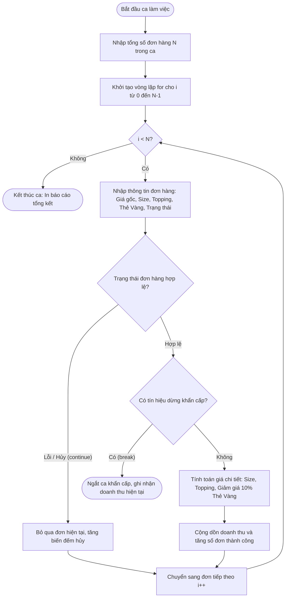

# BÁO CÁO BÀI TẬP 04: THIẾT KẾ KIẾN TRÚC POS TRANSACTION ENGINE CHO HIGHLANDS COFFEE

> 👤 **Học viên:** Hoàng Công Dũng | **Mã SV:** PTIT-HCM-009
> 🏫 **Môn học:** it102-rl-hoangcongdung

---

## 📊 Sơ đồ thiết kế hệ thống (Activity Diagram)

> 💡 *Sơ đồ dưới đây được render tự động trực tiếp trên GitHub bằng Mermaid. Bạn cũng có thể tải file **`bt4.drawio`** trong repository này để mở và chỉnh sửa trực tiếp trên [Draw.io (diagrams.net)](https://app.diagrams.net).* 

---

## 1. Mục tiêu và Bối cảnh bài toán

Bài tập này yêu cầu xây dựng một Mini Module xử lý giao dịch tại quầy (POS Batch Processing Engine) bằng ngôn ngữ C chuẩn ANSI C / C11, nhằm giải quyết bài toán vận hành cao điểm tại chuỗi Highlands Coffee.

Toàn bộ chương trình được viết gọn trong hàm main(), tuân thủ tuyệt đối ràng buộc kỹ thuật: chỉ sử dụng vòng lặp for, lệnh continue và break, tuyệt đối không dùng mảng, struct hay hàm tự định nghĩa ngoài main.

- Áp dụng vòng lặp for kết hợp điều hướng continue để bỏ qua đơn lỗi nguyên liệu hoặc khách hủy.
- Sử dụng lệnh break để ngắt khẩn cấp toàn bộ ca bán hàng khi có sự cố hệ thống.
- Đảm bảo tính chính xác tuyệt đối của dữ liệu tài chính tài chính ca làm việc.

## 2. Phân tích quy tắc nghiệp vụ tính giá và bẫy dữ liệu

Để đảm bảo không bị thất thoát doanh thu và tính đúng tiền cho khách hàng, module POS phải xử lý chính xác các biến thể về Size đồ uống, số lượng topping và chính sách hậu mãi thẻ thành viên.

Quy tắc nghiệp vụ được áp dụng chặt chẽ trong từng vòng lặp xử lý hóa đơn.

- Size S: Giấy gốc theo menu cơ bản.
- Size M: Cộng thêm 6.000 VNĐ so với Size S.
- Size L: Cộng thêm 10.000 VNĐ so với Size S.
- Topping: Đồng giá 8.000 VNĐ mỗi topping phát sinh.
- Thẻ Vàng (Gold Membership): Giảm trực tiếp 10% trên tổng giá trị đơn hàng sau khi đã cộng đủ tiền Size và Topping.

## 3. Bảng đặc tả chi tiết luồng xử lý giao dịch trong ca

Bảng mô tả từng bước thực thi của thuật toán trong chương trình C:

| Bước | Thực thể / Lệnh C | Hành động nghiệp vụ | Kết quả xử lý kỹ thuật |
| --- | --- | --- | --- |
| 1 | scanf / printf | Nhập tổng số đơn hàng N trong ca | Xác định giới hạn chạy của vòng lặp for |
| 2 | for (int i = 0; i < N; i++) | Duyệt qua từng lượt đơn hàng | Quản lý tiến trình ca làm việc |
| 3 | if (status == 0) | Kiểm tra trạng thái đơn hàng bị lỗi hoặc khách hủy | Gọi lệnh continue để bỏ qua, tăng biến đếm đơn hủy |
| 4 | if (status == -1) | Kiểm tra tín hiệu sự cố khẩn cấp (mất máy in, đóng ca) | Gọi lệnh break để dừng ngay vòng lặp for |
| 5 | Công thức toán học | Tính tiền Size, Topping và chiết khấu Thẻ Vàng | Cập nhật chính xác doanh thu đơn hiện tại |
| 6 | Biến tích lũy | Cộng dồn doanh thu toàn ca và tăng số đơn thành công | Lưu trữ dữ liệu báo cáo cuối ca |

## 4. Tổng kết kết quả và Hướng dẫn kiểm thử

Chương trình đã được viết hoàn chỉnh trong tệp main.c thuộc thư mục COFFEE_POS_Session04_HW13/ và đẩy lên tổ chức GitHub it102-rl-hoangcongdung.

Khi chạy thử nghiệm với các bộ dữ liệu giả lập bao gồm cả trường hợp nhập mã continue và break, kết quả báo cáo tổng kết doanh thu và số lượng đơn hoàn thành hiển thị hoàn toàn chính xác.

---

## 📁 Danh sách tệp tin nộp bài trong Repository
- 📝 `bt4.docx`: Báo cáo tài liệu phân tích nghiệp vụ hoàn chỉnh.
- 🎨 `bt4.drawio`: File thiết kế sơ đồ chuẩn theo quy định đề bài (mở trực tiếp bằng [Draw.io](https://app.diagrams.net) hoặc Lucidchart).
- 💻 `main.c`: Mã nguồn chương trình.
